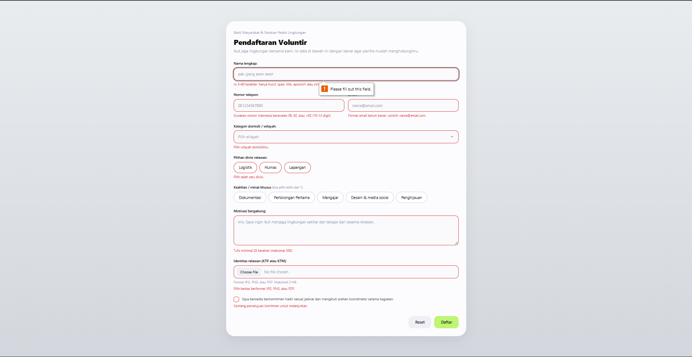
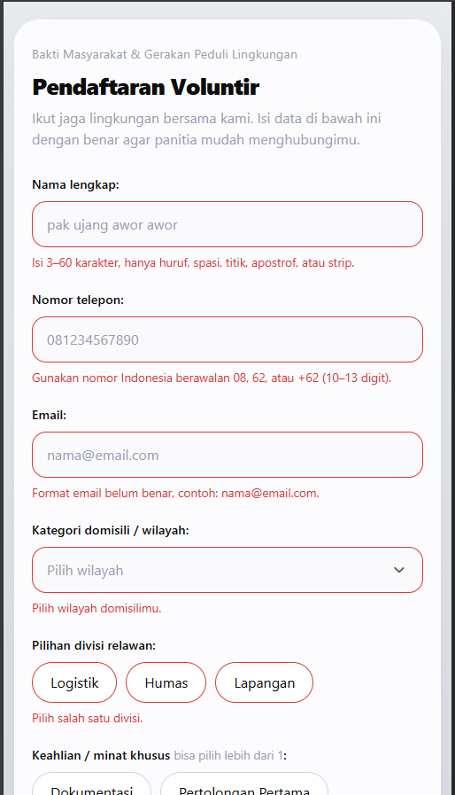

# Bukti yang Dikumpulkan

## 1. Source Code / Folder Project

Proyek ini berisi antarmuka web statis untuk formulir Pendaftaran Voluntir (Bakti Masyarakat & Gerakan Peduli Lingkungan). Berikut adalah rincian file yang dikumpulkan:

* **`index.html`**: File utama yang berisi kerangka (HTML5) formulir. Di dalamnya terdapat implementasi elemen form interaktif dengan atribut validasi seperti `required`, `minlength`, `maxlength`, `pattern`, dan `inputmode`.
* **`style.css`**: File penataan gaya (CSS3) yang mencakup pewarnaan tema terang dengan aksen *lime*, tipografi, tata letak *grid* responsif, modifikasi input, dan gaya peringatan (error) kustom.

---

## 2. Screenshot Hasil (Skenario Input yang Salah)

*(Catatan: Ganti placeholder gambar di bawah ini dengan screenshot asli Anda. Jalankan file HTML, tekan tombol "Daftar" dalam keadaan form kosong, atau isi form dengan data yang salah).*

### Tampilan Desktop

> **Keterangan:** Tampilan pada layar desktop saat pengguna mencoba mendaftar namun data tidak valid (misal: format nomor HP salah, atau opsi wajib tidak dipilih). Sistem memberikan *feedback* visual berupa border merah (`var(--error)`) dan memunculkan teks panduan di bawah setiap input yang bermasalah.

### Tampilan Mobile

> **Keterangan:** Tampilan pada layar *smartphone* (lebar di bawah 520px). Formulir menyesuaikan diri dari format dua kolom menjadi satu kolom vertikal. Elemen *error* tetap mudah dibaca agar pengguna tidak kebingungan saat memperbaiki isian melalui ponsel.

---

## 3. Penjelasan: Perubahan, Masalah, dan Solusi

### A. Validasi Error Form yang Kurang Menarik (UX)
* **Masalah:** Mengandalkan peringatan *default* bawaan browser (seperti pop-up "Please fill out this field") terlihat kaku, tidak menyatu dengan desain UI, dan terkadang pesannya membingungkan pengguna.
* **Solusi:** Saya memanfaatkan pseudo-class CSS modern `:user-invalid` dikombinasikan dengan `:has()`. Sistem CSS ini memungkinkan input berubah warna menjadi merah dan memunculkan elemen `<small class="pesan">` **hanya setelah** pengguna berinteraksi dengan field tersebut (misalnya setelah pengetikan selesai atau mencoba submit). Ini memberikan *User Experience* yang lebih halus tanpa menggunakan JavaScript.

### B. Modifikasi Desain Radio Button & Checkbox
* **Masalah:** Elemen asli `<input type="radio">` dan `<input type="checkbox">` bawaan browser sangat sulit diatur desainnya agar terlihat modern seperti bentuk tombol/kapsul (*pills*).
* **Solusi:** Saya menyembunyikan `<input>` aslinya secara visual dengan `opacity: 0` dan `position: absolute`, sehingga areanya tetap bisa diklik. Desain visualnya kemudian digantikan oleh elemen `` di sebelahnya. Menggunakan logika CSS `:checked + span`, tampilan kapsul akan berubah warna (`#f3f4f9`) dan menampilkan ikon centang SVG saat opsi tersebut dipilih.

### C. Responsivitas Tata Letak pada Layar Kecil
* **Masalah:** Input "Nomor telepon" dan "Email" didesain bersebelahan untuk menghemat ruang di layar desktop. Jika dibuka di HP (layar kecil), posisi bersebelahan ini akan membuat isian menjadi terlalu sempit dan teksnya terpotong.
* **Solusi:** Saya menggunakan sistem **CSS Grid**. Pada kelas `.baris`, layout awalnya dibagi dua secara berimbang (`grid-template-columns: 1fr 1fr`). Lalu, saya menambahkan **Media Query** `@media (max-width: 520px)`. Saat layar mengecil, instruksi grid diubah menjadi `1fr` saja (satu kolom), sehingga "Nomor telepon" dan "Email" secara otomatis tersusun ke bawah (vertikal) dan tetap nyaman digunakan di perangkat *mobile*.