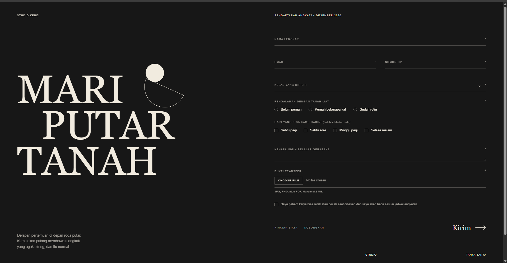
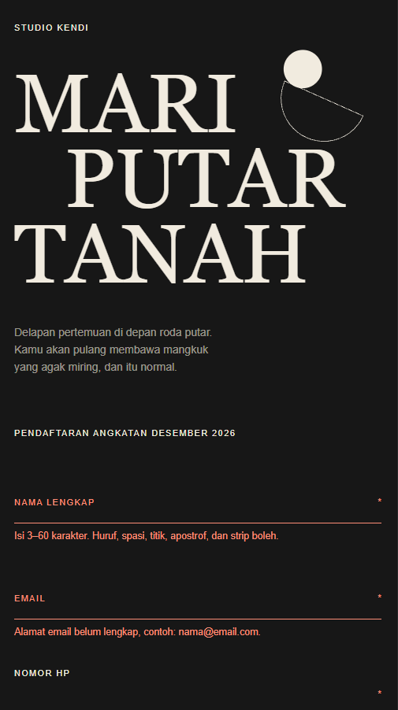

# Bukti yang Dikumpulkan

## 1. Source Code / Folder Project
Proyek ini berisi antarmuka web statis untuk formulir pendaftaran kelas gerabah (Studio Kendi). Berikut adalah rincian file yang dikumpulkan dalam proyek ini:

*   **`index.html`**: Struktur utama halaman (HTML5), memuat tata letak *grid*, elemen formulir dengan atribut validasi bawaan (`required`, `pattern`, `minlength`, dll), dan elemen `<dialog>`/`popover` murni HTML.
*   **`style.css`**: Kode penataan gaya (CSS3). Termasuk implementasi desain responsif, *custom properties* (variabel CSS), dan validasi visual form murni CSS menggunakan pseudo-class `:user-invalid`.
*   **`fonts/`**: Folder berisi aset font lokal (Bodoni Moda dan Hanken Grotesk).

---

## 2. Screenshot Hasil (Skenario Input yang Salah)

*(Catatan: Ganti placeholder gambar di bawah ini dengan path/link screenshot asli Anda yang menunjukkan form dalam keadaan merah/error setelah disubmit dengan input kosong atau salah)*

### Tampilan Desktop

*Keterangan: Tampilan pada layar desktop saat pengguna mencoba mengirimkan formulir tanpa mengisi kolom yang diwajibkan atau saat format email/nomor HP tidak sesuai. Border bawah input, label, dan ikon bintang berubah menjadi merah, serta pesan bantuan (error) muncul di bawah setiap field.*

### Tampilan Mobile

*Keterangan: Tampilan pada layar *smartphone* (di bawah 960px). Layout berubah menjadi satu kolom, dan elemen error tetap terlihat jelas untuk memandu pengguna memperbaiki isian mereka.*

---

## 3. Penjelasan: Perubahan, Masalah, dan Solusi

### A. Perubahan (Pendekatan Utama)
*   **Validasi Murni CSS (Tanpa JavaScript):** Menghindari penggunaan JavaScript untuk validasi awal. Form ini mengandalkan atribut HTML5 seperti `pattern="[A-Za-z .'\-]{3,60}"` untuk Nama, dan meresponsnya menggunakan fitur CSS modern `:user-invalid` bersama *pseudo-class* `:has()` untuk memunculkan pesan error (`.pesan`).
*   **Desain Label Dinamis (*Floating Label*):** Label ditempatkan di atas garis input menggunakan trik CSS `:not(:placeholder-shown)` dan `:focus`, sehingga label bergeser ke atas saat input diisi atau difokuskan.
*   **Implementasi HTML API Baru (`popover`):** Untuk fitur "Rincian biaya", alih-alih menggunakan JavaScript untuk membuat *modal/popup*, kode ini menggunakan atribut `popover` dan `popovertarget` bawaan HTML modern.

### B. Masalah yang Dihadapi
1.  **Pesan Error Muncul Terlalu Dini:** Jika menggunakan pseudo-class `:invalid` standar pada CSS, seluruh form akan langsung memerah (error) saat halaman pertama kali dimuat karena kolom yang `required` masih kosong. Hal ini memberikan *User Experience* (UX) yang buruk.
2.  **Kustomisasi Input File:** Elemen `<input type="file">` bawaan browser sangat sulit diatur penataannya agar seragam dengan desain bertema gelap (*dark mode*) situs ini.
3.  **Responsivitas Judul (Tipografi):** Tulisan "Mari putar tanah" yang sangat besar dapat menabrak layar atau meluber ke luar kontainer saat dibuka di layar *mobile*.

### C. Solusi yang Diterapkan
1.  **Penggunaan `:user-invalid`:** Untuk mencegah form memerah di awal, CSS diubah menjadi menggunakan `:user-invalid` (misalnya `:is(input, select, textarea):user-invalid`). Pseudo-class ini pintar karena hanya memicu warna `--error` (merah) dan menampilkan teks peringatan **setelah** pengguna berinteraksi dengan field tersebut atau setelah mereka mencoba menekan tombol "Kirim".
2.  **Menggunakan `::file-selector-button`:** Untuk menyesuaikan tombol unggah file, digunakan *pseudo-element* `::file-selector-button`. Dengan ini, tombol *default* "Choose File" dari browser dapat diberi border, padding, warna teks, dan efek *hover* yang sesuai dengan identitas visual Studio Kendi tanpa perlu menyembunyikan input aslinya.
3.  **Fungsi `clamp()` pada CSS:** Ukuran font pada `h1` diatasi dengan menggunakan `font-size: clamp(3.8rem, 21vw, 7rem)`. Dengan solusi ini, font akan mengecil secara mulus (mengikuti 21vw) pada layar sempit, namun tidak akan lebih kecil dari 3.8rem dan tidak lebih besar dari 7rem pada layar lebar. Layout Grid (`grid-template-columns`) juga diubah menjadi `block` (satu kolom) menggunakan Media Query pada maksimal lebar 960px.